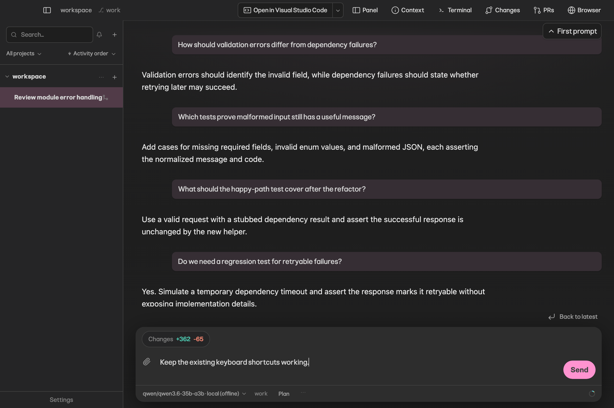
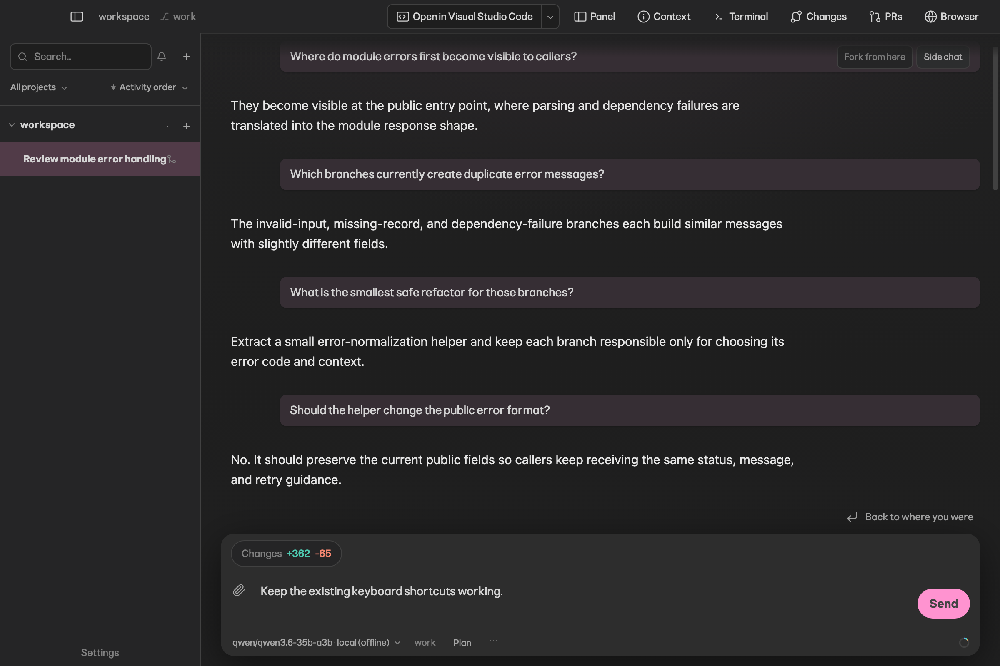

# First prompt navigation

A small chevron reveals “First prompt” on hover or keyboard focus. Selecting it opens the earliest
human prompt. “Back to where you were” restores the saved reading position and leaves the draft
intact. During ordinary browsing the action says “Back to latest”. Both controls share one reserved,
right-aligned row above the composer, outside the scrollable transcript, so neither can cover
messages, the TODO counter or prompt text.

The two local captures below predate that move: they show First prompt as an overlay at the top
right of the transcript, which the screenshot audit found covering content. The current placement
is proved by `navigationTextOverlaps()` in `tests/e2e/scroll-to-bottom.e2e.ts` and the CI reference
candidates, not by these images.

## Local Electron evidence

These are local macOS captures of the actual app with deterministic seeded conversation data, not
CI screenshot baselines. They are not replacements for the Linux reference images.

The focused specification is `tests/e2e/scroll-to-bottom.e2e.ts`. It verifies the first prompt,
exact return position, unchanged draft, no hover reflow, return placement below the transcript and
above the composer, right alignment, readable contrast in dark/light themes, ordinary latest
navigation, and streaming scroll behavior. Component coverage lives in
`src/renderer/views/conversation-first-prompt.test.ts`.

Visual review: both controls fit at the right edge, the return action has no pink fill or shadow,
and the reserved row keeps it clear of transcript text. The draft and composer remain visible.
