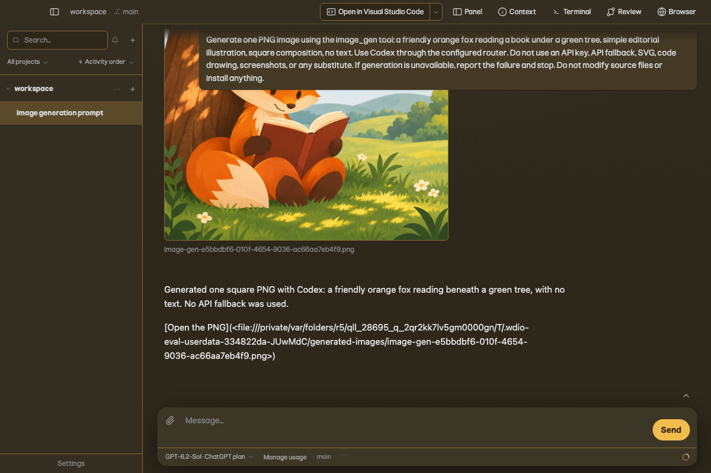
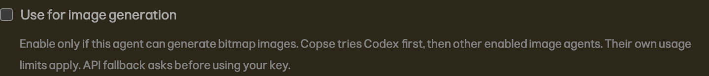
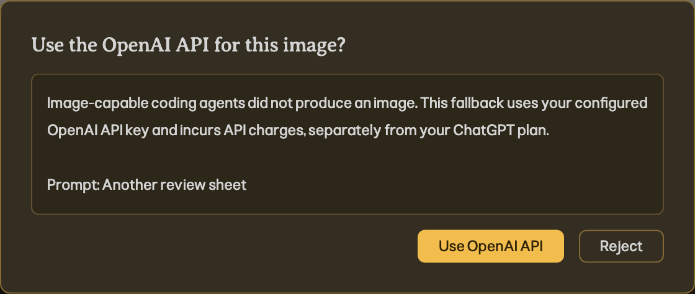

# Image generation routing evidence

## Real plan → Codex ACP run

Passed on 27 November 2026 on macOS, controlled from Codex desktop through the repository's
WebdriverIO Electron harness. The tested source was `bca1bf085` plus the image-routing changes
(uncommitted diff SHA-256 `ca607a2ecbe304a0fa98681df7be68c27aad72fa50624fd3e49797b0635f4a6e`).
The PR was subsequently rebased onto `151d3d114`; this live run predates that rebase.

| Check              | Observed result                                                                                                        |
| ------------------ | ---------------------------------------------------------------------------------------------------------------------- |
| Main provider      | Native OpenAI ChatGPT plan, `gpt-6.2-sol`                                                                              |
| Image runner       | Real `@agentclientprotocol/codex-acp` 2.12.0; Codex CLI 0.171.0; ChatGPT login                                         |
| Isolation          | Fresh app profile and disposable Git project; normal desktop instance lock; default runner permissions and sandbox     |
| Request            | One orange fox reading under a green tree, square illustration, no text                                                |
| Main tool calls    | `read_skill`: 1; `image_gen`: 1                                                                                        |
| Native Codex tool  | Rollout confirms `image_gen__imagegen`                                                                                 |
| Result             | Valid 1254 × 1254 PNG, 2,139,860 bytes; saved durably and displayed inline                                             |
| Paid API exclusion | No configured OpenAI API key, asserted before and after; `OPENAI_API_KEY` and `CODEX_API_KEY` blank for app and runner |
| Approvals/fallback | No runner permission prompt and no paid API fallback                                                                   |
| Driver/analyzer    | 1/1 live Electron case passed (93 seconds); thread analyzer passed without violations                                  |
| Cleanup            | Isolated registration revoked; runner scratch empty; project Git-clean; no test-profile processes remaining            |

PNG SHA-256: `8e760cf26ed7dc3b4c3a9ae772977901e6b18457b239c2826974e4b9e988bfd6`.
The model requested 1024 × 1024; the native generator returned 1254 × 1254. The router validates
PNG bytes rather than enforcing exact requested dimensions.

The reviewed screenshot shows the actual returned image and the ChatGPT plan selection in the
composer. Its upper part is covered by the existing sticky prompt; the full exported PNG was also
inspected and matches the requested subject. The final model response's `file://` Markdown link
is shown as literal text, but the tool-result bitmap itself renders correctly.



Commands used, with isolated-profile and API-key exclusions configured by the local driver:

```sh
node scripts/run-e2e.mts .tmp/image-live/wdio.desktop.conf.ts
pnpm run analyze:thread .tmp/image-live/thread.jsonl .tmp/image-live/scenario.json
```

The raw local trace, generated PNG, driver, scenario and report remain under `.tmp/image-live/`.
They are not published: only these screenshots and summarized results are included in the PR.
The stock eval host rejects plan inference, so the live test used normal desktop mode with its
instance lock and supported browser login. Two preliminary harness attempts stopped before
generation (the eval-host restriction and a corrected model-filter interaction).

Codex's shell and `node_repl` helpers still reported `sandbox_apply: Operation not permitted`.
Native image generation succeeded despite those errors. This run does not establish a sandbox
fix, general provider availability or repeatability across accounts. No paid Images API request
was made, so the paid API's live success path remains untested.

## Deterministic Electron coverage

Final validation after rebasing onto `151d3d114`: build passed; both focused Electron cases passed;
their setting and approval captures exactly match the reviewed images below. `pnpm run check`
passed all static stages and ran 20,011 tests: 19,996 passed, 12 skipped, 3 failed. The failures are
the two `scripts/coverage-gate.test.ts` area/floor assertions and the
`src/main/services/diagnostics/checkup.test.ts` concurrent-root assertion (host crash record contains
“window”). All three reproduced on a separately installed clean `bca1bf085`; those files are
unchanged in `151d3d114`. No new failures or source/index changes during the run were reported.
The earlier focused suite passed 103 checks; the full run includes those cases.

`tests/e2e/image-gen-routing.e2e.ts` passed both cases using a real ACP fixture subprocess and
mock main-model turns, with no live model or Images API usage. It verifies returned image display,
the persisted image-runner setting (including retention of sandbox and model options), and the
explicit API cost approval before rejecting that fallback. The following captures were inspected
for legibility, wrapping and correct labels; both states are clear and unclipped.




