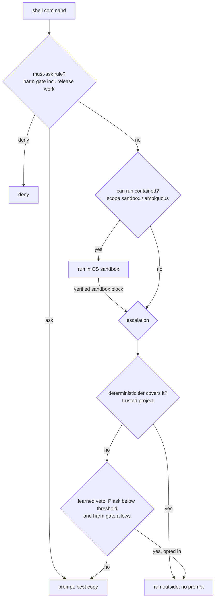

# Fewer permission prompts: measured on real history

Status: **Measured; first two fixes in this change.** Harness:
[`benchmarks/risk-classifier`](../../benchmarks/risk-classifier/README.md). Related:
[`auto-approval-classifier.md`](auto-approval-classifier.md),
[`command-sandboxing-routing.md`](command-sandboxing-routing.md),
[`../shell-permissions.md`](../shell-permissions.md),
[`../../benchmarks/escalation-review/README.md`](../../benchmarks/escalation-review/README.md).

## Goal and principles

Ask the developer almost never, without ever running a command a person must see. In order of
precedence:

1. The most serious risks always ask (or are denied), whatever any model says.
2. Prefer containment to permission: a command that can run inside the OS sandbox runs there.
3. Deterministic rules decide before any model. A model may only remove a prompt a deterministic
   gate already allows, never add authority.
4. When a prompt is needed, it is the best prompt we can show: one question, what will happen and
   why it needs a person.

Success is two numbers on **held-out real runs**: the share of today's prompts removed, and the
number of commands labelled `ask` that run unasked. The second must stay zero.

## Data

Three machines' Copse stores, read where they lay (nothing uploaded; training ran in a Colima VM
with `--network none`):

| Machine    | Shell calls |  Prompted | Of all tool calls | Answers                       |
| ---------- | ----------: | --------: | ----------------: | ----------------------------- |
| Mac Studio |       3,092 | 675 (22%) |              8.7% | 100% approved                 |
| MacBook    |       2,152 | 218 (10%) |              5.7% | Guarded YOLO on; all approved |
| Mac mini   |         100 |  21 (21%) |             11.5% | all approved                  |

Every recorded answer was an approval, so answers carry no signal about risk; as the
escalation-review study found, a blind rubric label is the only usable reference. 960 unique
commands were labelled against [`rubric.md`](../../benchmarks/escalation-review/rubric.md): the
Studio's 577 prompted commands, and the 383 the MacBook and mini either prompted for or ran
unsandboxed without asking. 86 are `ask`. Labels started from a heuristic pass and every `ask`, every
unmatched row and every family was read by hand.

Public data: the 782-case escalation-review test set (rubric tiers), and three Hugging Face sets
whose own policies only train an `ask` head: tomngdev/shell-safety-v1.1 (MIT),
yannelli/cli-command-risk and agentapprove/coding-agent-tool-call-safety (CC BY 4.0).

## Where the prompts come from

Studio, 675 shell prompts, by what the command needed:

| Bucket                                                       | Prompts | Share |
| ------------------------------------------------------------ | ------: | ----: |
| Toolchain bootstrap (`corepack`, `fnm env/exec`, nvm, Xcode) |     427 |   63% |
| Other workspace reads and writes (opaque scripts, heredocs)  |      85 |   13% |
| `git`/`gh` against the project's own remote                  |      68 |   10% |
| Reads outside the workspace                                  |      50 |    7% |
| Writes outside the workspace (`/tmp`, caches, other repos)   |      27 |    4% |
| Must ask                                                     |      13 |    2% |

Two causes dominate the toolchain bucket: the word `corepack` made a line hard-external (296
prompts), and `eval "$(fnm env)"` / `fnm exec` read as dynamic execution (161). The MacBook, in
Guarded YOLO, prompts mostly on opaque scripts (33%) and the same toolchain shapes (23%).

**No project was trusted.** Every Studio prompt recorded `workspaceTrusted: false`, so the
deterministic `read`/`local-write`/`remote-write` tiers, which require trust, never ran. Trusted at
`remote-write`, they would have removed 60 Studio prompts (9%) with no `ask` approved.

## What each approver does on held-out runs

Share of prompts removed / commands labelled `ask` approved. "Harm gate" is the Guarded YOLO gate
(`assessShellHarm`) as an approver; "main" is before this change.

| Approver                                                                  | Studio (577) | MacBook (362) | Mac mini (21) |
| ------------------------------------------------------------------------- | ------------ | ------------- | ------------- |
| Harm gate, main                                                           | 80% / **8**  | 47% / 0       | 76% / 0       |
| Harm gate, this change                                                    | 79% / 0      | 47% / 0       | 76% / 0       |
| TF-IDF veto (public data only), P(ask) < 0.1 + harm gate, main            | 34% / 0      | 5% / 0        | 14% / 0       |
| TF-IDF veto, P(ask) < 0.5 + harm gate, main                               | 69% / 4      | 37% / 0       | 67% / 0       |
| CodeBERTa encoder veto (public data only), P(ask) < 0.1 + harm gate, main | 37% / 0      | 9% / 0        | 29% / 0       |
| CodeBERTa encoder veto, P(ask) < 0.5 + harm gate, main                    | 64% / 0      | 26% / 0       | 67% / 0       |

Caveats. The release-work rules were written from the Studio's misses, so their Studio row is
in-sample; the MacBook and mini rows are the held-out test, and the models in this table never saw
private data. The gates replay from source on the Studio, so a script that only existed on another
machine reads as uninspectable and asks, which favours the gate slightly there. A row is one unique
command; "removed" counts its prompts. One labeller (Claude, against the rubric) produced the
labels, with no second labeller.

The harm gate on main allowed 8 of the Studio's 13 `ask` commands, all from one app release:
sourcing `.env.release`, piping the Sparkle key into `sign_update`, `make ship-release`, a forced
tag push and an appcast push with its own credential helper. The MacBook's 73 `ask` commands (ssh
to other machines, `pkill`, `screencapture`, `osascript`, `launchctl`) were all caught: the gate
was fixed for those families after the September study. Each new real workload finds a family
nobody wrote a rule for.

## Findings

1. **The biggest lever is containment, not classification.** 63% of the Studio's prompts were a
   toolchain the sandbox can already run. Fixing the scope rule for Corepack alone moves 162 Studio
   prompts (24%) from "ask" to "runs contained" with no `ask` among them; under Guarded YOLO the
   same commands now run inside the sandbox instead of outside it.
2. **Deterministic must-ask rules close real gaps cheaply.** The release-work rules catch all 8
   misses, add no prompt on the 289 non-`ask` held-out MacBook and mini commands, and tighten one
   public test case (a version-tag push).
3. **A learned model is a weak approver and a useful tripwire.** Trained without any private
   data, TF-IDF separates `ask` reasonably (AUC 0.87 Studio, 0.71 MacBook) but predicts tiers
   poorly (35 to 71%). As the only approver it removes far fewer prompts than the harm gate. As a
   veto on the harm gate it would have caught every one of the 8 release-work misses before any
   rule existed, but only at a threshold that cuts coverage from 80% to 34%.
4. **Fine-tuning helps the tripwire, not the approver.** CodeBERTa-small (84M parameters), fine-tuned
   for 12 minutes on a 12-core CPU VM with no private data, separates `ask` better than TF-IDF on
   the Studio (AUC 0.95 against 0.87) and scores all 8 release-work misses at P(ask) ≥ 0.5, so a
   veto at 0.5 stops every one of them, where TF-IDF let 4 through. On the MacBook both sit near
   AUC 0.70, and neither predicts tiers well enough to approve on its own. Adding the Studio's 577
   labelled prompts to training lifts the MacBook only a little (encoder AUC 0.70 to 0.73, TF-IDF
   0.71 to 0.79). So a small fine-tuned model earns its place as a second opinion behind the harm
   gate, cheap enough to run locally on every escalation; a bigger model, or more of your own
   labels, is worth it only once it beats that on a machine it has not seen.
5. **Prompts are friction today, not judgement.** Every answer on three machines was an approval.
   A prompt that is always approved trains the person to approve without reading, which is the
   failure the must-ask rules exist to prevent.

## Design: a blend, each layer with one job

| Layer               | Exists                                                                                   | Change                                                                                                                                                  |
| ------------------- | ---------------------------------------------------------------------------------------- | ------------------------------------------------------------------------------------------------------------------------------------------------------- |
| Must-ask rules      | Harm gate (`shell-harm.ts`, `host-reach.ts`, `remote-change.ts`, `secrets.ts`)           | **This change:** `release-actions.ts`. Next: grow from each new replay; every rule adds a prompt only.                                                  |
| Containment first   | Scope verdicts, ambiguous tier, toolchain read grants                                    | **This change:** Corepack ambiguous. Next: `fnm env`/`fnm exec` (192 Studio prompts still external), absolute toolchain paths and `DEVELOPER_DIR` (35). |
| Deterministic tiers | `auto-approval.ts` (`read` default; trust required)                                      | Next: offer trust when a person adds a project, so the tiers run at all.                                                                                |
| Learned veto        | Classifier connections (`ask_classifier`, Guarded YOLO tier second opinion, tier-shadow) | Keep as a veto on top of the harm gate, not an approver; train on public data plus each machine's own labelled prompts.                                 |
| Prompt              | Approval dialog                                                                          | One question per escalation; say which rule or verdict asked.                                                                                           |

A model never authorises alone: it is consulted only after the harm gate allows, and the gate's
`ask` is final.

## Next steps, by expected effect

1. Containment for `fnm env`/`fnm exec` and absolute toolchain paths: 227 Studio prompts (34%)
   still go external after the Corepack fix. `fnm env` writes a multishell link under
   `~/.local/state`, so it needs either that write grant or Copse putting the project's Node on
   `PATH` so agents stop bootstrapping it. Verify each shape starts in the macOS sandbox.
2. A trust offer on project add, so the deterministic tiers run (9% Studio).
3. Re-run this replay on every machine monthly; each new `ask` family becomes a rule and a
   regression case, each false positive a containment or tier fix.
4. Score the existing classifier connections (Winnow-12B, Kev) on the same held-out sets before
   building another model.
