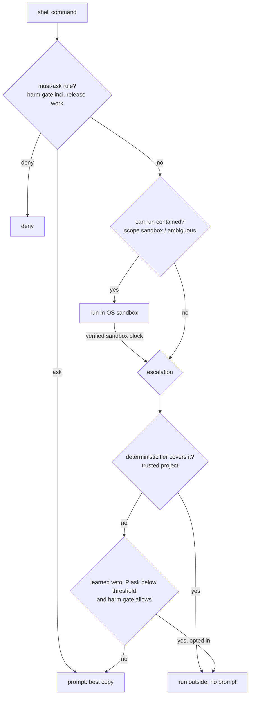

# Fewer permission prompts: measured on real history

Status: **Measured; must-ask release rules and Corepack and `fnm exec` containment in this change.** Harness:
[`benchmarks/risk-classifier`](../../benchmarks/risk-classifier/README.md). Related:
[`auto-approval-classifier.md`](auto-approval-classifier.md),
[`command-sandboxing-routing.md`](command-sandboxing-routing.md),
[`../shell-permissions.md`](../shell-permissions.md),
[`../../benchmarks/escalation-review/README.md`](../../benchmarks/escalation-review/README.md).

## Goal and principles

Ask the developer almost never, without ever running a command a person must see. In order of
precedence:

1. The most serious risks always ask (or are denied), whatever any model says.
2. Prefer containment to permission: a command that can run inside the OS sandbox runs there.
3. Deterministic rules decide before any model. A model may only remove a prompt a deterministic
   gate already allows, never add authority.
4. When a prompt is needed, it is the best prompt we can show: one question, what will happen and
   why it needs a person.

Success is two numbers on **held-out real runs**: the share of today's prompts removed, and the
number of commands labelled `ask` that run unasked. The second must stay zero.

## Data

Three machines' Copse stores, read where they lay (nothing uploaded; training ran in a Colima VM
with `--network none`, and on the host under Copse's sandbox profile; see
[Where training runs](#where-training-runs)):

| Machine    | Shell calls |  Prompted | Of all tool calls | Answers                       |
| ---------- | ----------: | --------: | ----------------: | ----------------------------- |
| Mac Studio |       3,092 | 675 (22%) |              8.7% | 100% approved                 |
| MacBook    |       2,152 | 218 (10%) |              5.7% | Guarded YOLO on; all approved |
| Mac mini   |         100 |  21 (21%) |             11.5% | all approved                  |

Every recorded answer was an approval, so answers carry no signal about risk; as the
escalation-review study found, a blind rubric label is the only usable reference. 960 unique
commands were labelled against [`rubric.md`](../../benchmarks/escalation-review/rubric.md): the
Studio's 577 prompted commands, and the 383 the MacBook and mini either prompted for or ran
unsandboxed without asking. 86 are `ask`. Labels started from a heuristic pass and every `ask`, every
unmatched row and every family was read by hand.

Public data: the 782-case escalation-review test set (rubric tiers), and three Hugging Face sets
whose own policies only train an `ask` head: tomngdev/shell-safety-v1.1 (MIT),
yannelli/cli-command-risk and agentapprove/coding-agent-tool-call-safety (CC BY 4.0).

## Where the prompts come from

Studio, 675 shell prompts, by what the command needed:

| Bucket                                                       | Prompts | Share |
| ------------------------------------------------------------ | ------: | ----: |
| Toolchain bootstrap (`corepack`, `fnm env/exec`, nvm, Xcode) |     427 |   63% |
| Other workspace reads and writes (opaque scripts, heredocs)  |      85 |   13% |
| `git`/`gh` against the project's own remote                  |      68 |   10% |
| Reads outside the workspace                                  |      50 |    7% |
| Writes outside the workspace (`/tmp`, caches, other repos)   |      27 |    4% |
| Must ask                                                     |      13 |    2% |

Two causes dominate the toolchain bucket: the word `corepack` made a line hard-external (296
prompts), and `eval "$(fnm env)"` / `fnm exec` read as dynamic execution (161). The MacBook, in
Guarded YOLO, prompts mostly on opaque scripts (33%) and the same toolchain shapes (23%).

**No project was trusted.** Every Studio prompt recorded `workspaceTrusted: false`, so the
deterministic `read`/`local-write`/`remote-write` tiers, which require trust, never ran. Trusted at
`remote-write`, they would have removed 60 Studio prompts (9%) with no `ask` approved.

## What each approver does on held-out runs

Share of prompts removed / commands labelled `ask` approved. "Harm gate" is the Guarded YOLO gate
(`assessShellHarm`) as an approver; "main" is before this change.

| Approver                                                                       | Studio (577) | MacBook (362) | Mac mini (21) |
| ------------------------------------------------------------------------------ | ------------ | ------------- | ------------- |
| Harm gate, main                                                                | 80% / **8**  | 47% / 0       | 76% / 0       |
| Harm gate, this change                                                         | 79% / 0      | 47% / 0       | 76% / 0       |
| TF-IDF veto (public data only), P(ask) < 0.1 + harm gate, main                 | 34% / 0      | 5% / 0        | 14% / 0       |
| TF-IDF veto, P(ask) < 0.5 + harm gate, main                                    | 69% / 4      | 37% / 0       | 67% / 0       |
| CodeBERTa encoder veto (public data only), P(ask) < 0.1 + harm gate, main      | 37% / 0      | 9% / 0        | 29% / 0       |
| CodeBERTa encoder veto, P(ask) < 0.5 + harm gate, main                         | 64% / 0      | 26% / 0       | 67% / 0       |
| Gradient-boosted trees veto (public data only), P(ask) < 0.1 + harm gate, main | 80% / **8**  | 47% / 0       | 76% / 0       |
| Gradient-boosted trees veto, P(ask) < 0.5 + harm gate, main                    | 80% / **8**  | 47% / 0       | 76% / 0       |
| Winnow-12B veto (existing connection, local), P(ask) < 0.5 + harm gate, main   | 70% / **4**  | 30% / 0       | 76% / 0       |
| Winnow-12B veto, P(ask) < 0.1 + harm gate, main                                | 57% / 1      | 22% / 0       | 76% / 0       |

Caveats. The release-work rules were written from the Studio's misses, so their Studio row is
in-sample; the MacBook and mini rows are the held-out test, and the models in this table never saw
private data. The gates replay from source on the Studio, so a script that only existed on another
machine reads as uninspectable and asks, which favours the gate slightly there. A row is one unique
command; "removed" counts its prompts. One labeller (Claude, against the rubric) produced the
labels, with no second labeller.

The harm gate on main allowed 8 of the Studio's 13 `ask` commands, all from one app release:
sourcing `.env.release`, piping the Sparkle key into `sign_update`, `make ship-release`, a forced
tag push and an appcast push with its own credential helper. The MacBook's 73 `ask` commands (ssh
to other machines, `pkill`, `screencapture`, `osascript`, `launchctl`) were all caught: the gate
was fixed for those families after the September study. Each new real workload finds a family
nobody wrote a rule for.

## Findings

1. **The biggest lever is containment, not classification.** 63% of the Studio's prompts were a
   toolchain the sandbox can already run. Fixing the scope rule for Corepack alone moves 162 Studio
   prompts (24%) from "ask" to "runs contained" with no `ask` among them; under Guarded YOLO the
   same commands now run inside the sandbox instead of outside it.
2. **Deterministic must-ask rules close real gaps cheaply.** The release-work rules catch all 8
   misses, add no prompt on the 289 non-`ask` held-out MacBook and mini commands, and tighten one
   public test case (a version-tag push).
3. **A learned model is a weak approver and a useful tripwire.** Trained without any private
   data, TF-IDF separates `ask` reasonably (AUC 0.87 Studio, 0.71 MacBook) but predicts tiers
   poorly (35 to 71%). As the only approver it removes far fewer prompts than the harm gate. As a
   veto on the harm gate it would have caught every one of the 8 release-work misses before any
   rule existed, but only at a threshold that cuts coverage from 80% to 34%.
4. **Fine-tuning helps the tripwire, not the approver.** CodeBERTa-small (84M parameters), fine-tuned
   for 12 minutes on a 12-core CPU VM with no private data, separates `ask` better than TF-IDF on
   the Studio (AUC 0.95 against 0.87) and scores all 8 release-work misses at P(ask) ≥ 0.5, so a
   veto at 0.5 stops every one of them, where TF-IDF let 4 through. On the MacBook both sit near
   AUC 0.70, and neither predicts tiers well enough to approve on its own. Adding the Studio's 577
   labelled prompts to training lifts the MacBook only a little (encoder AUC 0.70 to 0.73, TF-IDF
   0.71 to 0.79). So a small fine-tuned model earns its place as a second opinion behind the harm
   gate, cheap enough to run locally on every escalation; a bigger model, or more of your own
   labels, is worth it only once it beats that on a machine it has not seen.
5. **A tree model that reads the gate's verdict cannot cover the gate's blind spots.**
   Gradient-boosted trees over the harm and scope verdicts plus a few dozen command-shape flags
   reach AUC 0.90 on the held-out MacBook, but only because every MacBook `ask` was one the harm
   gate already asked about. On the Studio's release-work misses, where the gate said allow, they
   score AUC 0.68 and a veto at any threshold up to 0.5 stops none of the 8; training on the MacBook
   too (Studio held out) gives 0.75 and still none. A first run of this comparison reported the
   trees catching all 8: it had fed them this change's harm verdict, which already asks for those
   commands, and is corrected here. The tree model is a good summary of the gate, not a second
   opinion on it. A shape-only tree model is no better (Studio AUC 0.62).
6. **The only learned tripwire that worked is the text encoder, and it costs coverage.** The
   public-trained CodeBERTa veto at P(ask) < 0.5 stops all 8 misses, but removes 64% of Studio
   prompts instead of 80%, and 26% of MacBook prompts instead of 47%. That is a real price for
   families that are rare, so it belongs where Copse already puts a model second opinion (the
   classifier connection under Guarded YOLO), opt-in and measured, not on by default.
   Winnow-12B, the LLM Copse already offers in that slot, ranks `ask` best on the MacBook (AUC
   0.95; Studio 0.90), but at its shipped threshold of P(ask) ≥ 0.5 it lets 4 of the 8 misses
   through and still costs coverage (Studio 80% to 70%, MacBook 47% to 30%). No model tried here
   is a free second opinion: each one either misses the blind spot or adds prompts.
7. **Prompts are friction today, not judgement.** Every answer on three machines was an approval.
   A prompt that is always approved trains the person to approve without reading, which is the
   failure the must-ask rules exist to prevent.

## Red team: disguised must-ask commands

Eight real misses are too few to trust zero. `redteam_gen.py` writes 868 synthetic must-ask
commands: 85 base commands over 11 families (secret loading and reading, release signing and entry
points, tag publishing, credential overrides, remote shells, system and process control, download
and run, destructive, exfiltration), each behind up to ten disguises (`bash -c`, `sh -lc`, `env`,
`nohup`, `timeout`, `fnm exec`, a `cd` chain, after a build, inside a multi-line script).

| Harm gate   | Must-ask variants it runs unasked |
| ----------- | --------------------------------: |
| main        |                   334 / 868 (38%) |
| this change |                           0 / 868 |

This change closes four more families the red team found (a secret fed through `<`, a secret
copied elsewhere, `GIT_ASKPASS`/`core.sshCommand`, `ssh-add` that changes identities, and `env`
behind another wrapper), with no new prompt on the three machines' real history. The red team was
written by the same hand as the rules, so zero here is a floor on effort, not proof.

**Is more data the limit for a learned veto?** Leave one red-team family out and train TF-IDF on
public data, the other families (gate misses weighted up) and Studio non-`ask` commands: it catches
84% of the held-out family's gate misses at P(ask) ≥ 0.5 for about 1% more MacBook prompts (93% at
0.3). Gradient-boosted trees catch 61%. But synthetic families share a writer's style. On the real
test (trained on public data, the plain red-team variants and MacBook negatives, nothing from the
Studio), TF-IDF catches 4 of the Studio's 8 real misses for 3% more Studio prompts, or 5 for 9%;
the trees catch none. More, better-targeted data helps the text model a lot on synthetic families
and only partly on real ones. Deterministic rules stay the floor; a data-fed text veto is a
partial net on top.

**Fine-tuned on an independent adversarial set.** A separate generator (#4531: one Claude source,
two external models; 617 rows, most must-ask commands paired with a safe twin that differs in the
detail that matters) found this change's harm gate letting about half its must-ask rows through
(209 of 404), mostly where the risk sits in a project script, a launcher or config. The rows list
commands that get past the gate, so they stay out of the repository; `join_verdicts.mjs` adds the
gates' verdicts to a regenerated set. On the sample at 9527fccf1, trained on the Claude rows and
tested on the external models' (`adversarial_finetune.py`, pairs kept together): TF-IDF catches 40
of 44 gate misses at P(ask) ≥ 0.5 but flags 28 of 40 safe twins and would add 27 of the MacBook's
218 prompts (12%); the MLX encoder catches 18, adding 41; adding the script files' text does not
help (36, adding 31). With whole families held out, TF-IDF catches 92% (186 of 203) for about 11%
more MacBook prompts. The models
learn what adversarial commands look like more than what they do, so the price in prompts stays
high. Containing those commands (opt-in contain-first Guarded YOLO) and protecting the config they
persist through are the structural answers; a learned veto remains an optional extra.

**Code mode** (Codex's orchestration cells) already removes the prompt per cell when Codex runs in
the project sandbox. It does not change the prompts measured here: 99% of the Studio's shell
prompts came from Codex sessions, and they are the concrete commands inside those cells, which
still pass the shell gate.

## Design: a blend, each layer with one job

| Layer               | Exists                                                                                   | Change                                                                                                                                                  |
| ------------------- | ---------------------------------------------------------------------------------------- | ------------------------------------------------------------------------------------------------------------------------------------------------------- |
| Must-ask rules      | Harm gate (`shell-harm.ts`, `host-reach.ts`, `remote-change.ts`, `secrets.ts`)           | **This change:** `release-actions.ts`. Next: grow from each new replay; every rule adds a prompt only.                                                  |
| Containment first   | Scope verdicts, ambiguous tier, toolchain read grants                                    | **This change:** Corepack and `fnm exec` contained. Next: `eval "$(fnm env)"`, absolute toolchain paths and `DEVELOPER_DIR`.                             |
| Deterministic tiers | `auto-approval.ts` (`read` default; trust required)                                      | Next: offer trust when a person adds a project, so the tiers run at all.                                                                                |
| Learned veto        | Classifier connections (`ask_classifier`, Guarded YOLO tier second opinion, tier-shadow) | Keep as a veto on top of the harm gate, not an approver; train on public data plus each machine's own labelled prompts.                                 |
| Prompt              | Approval dialog                                                                          | One question per escalation; say which rule or verdict asked.                                                                                           |

A model never authorises alone: it is consulted only after the harm gate allows, and the gate's
`ask` is final.

## Where training runs

| Where                                        | Encoder, 2 epochs | Isolation                                                                          |
| -------------------------------------------- | ----------------: | ---------------------------------------------------------------------------------- |
| Colima VM (12 vCPU, `--network none`)        |          12.5 min | Linux VM; only mounted folders visible                                             |
| Host, Copse sandbox profile, CPU (PyTorch)   |          10.1 min | no network, home unreadable but the checkout and Python, writes only to the output |
| Host, Copse sandbox profile, Apple GPU (MLX) |           2.6 min | the same, plus the GPU                                                             |

The VM protects against the training process, not its output: the weights are the same wherever
they are trained, and a checkpoint trained on private labels stays private either way. On the
host, `host-train.sh` builds the profile from ASRT, which hides the GPU (it allows no GPU IOKit user
client), and adds only the GPU's user clients, Metal's compiler service and the per-user Metal
caches. PyTorch's MPS backend still fails there: it compiles some kernels at runtime in Apple's
`MTLCompilerService`, which applies its own policy and will not write its cache for a client under
`sandbox-exec`. MLX ships precompiled kernels and trains on the GPU inside the sandbox, so the
encoder has an MLX port (`mlx_encoder.py`, same model and losses, AUC within noise of PyTorch). A
probe in the script checks that HTTPS, raw TCP, `~/.ssh`, `~/.copse` and writes outside the output
fail from inside the run. The host's dependencies are hash-pinned and no newer than two weeks; the container's Dockerfile
pins versions only.

## Next steps, by expected effect

1. Containment for `eval "$(fnm env)"` and absolute toolchain paths: 140 Studio prompts (21%)
   still go external after the Corepack and `fnm exec` fixes. `fnm env` writes a multishell link
   under `~/.local/state`, so it needs either that write grant or Copse putting the project's Node
   on `PATH` so agents stop bootstrapping it. Verify each shape starts in the macOS sandbox.
2. A trust offer on project add, so the deterministic tiers run (9% Studio).
3. Re-run this replay on every machine monthly; each new `ask` family becomes a rule and a
   regression case, each false positive a containment or tier fix.
4. Score Kev and Strands Decider on the same held-out sets, as Winnow-12B is here.
5. Keep must-ask families deterministic: each replay that finds a gate miss becomes a rule and a
   regression case. A learned veto is worth adding only when one stops a held-out miss without
   costing more prompts than the misses it stops.
